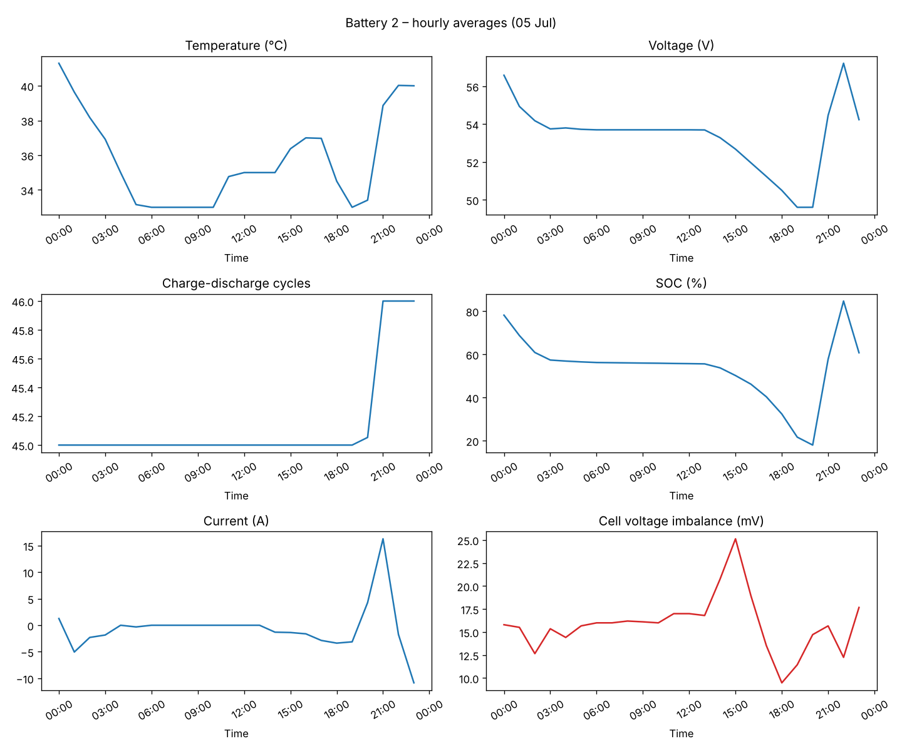

# Battery Health Monitoring

Exploratory analysis of Battery Management System (BMS) telemetry from five lithium-ion battery packs, looking for early signs of degradation.



## Data

`data/` holds one 24-hour BMS export per pack (05 July, one reading roughly every 30 seconds, about 13,700 readings in total). Each export has ~140 columns. The analysis uses:

| Signal | Why it matters |
|---|---|
| Pack temperature | Heat accelerates ageing |
| Pack voltage, SOC, current | Charge/discharge behaviour over the day |
| Charge-discharge cycles | Proxy for battery age |
| Individual cell voltages (14–15 cells) | Spread between cells signals imbalance |

## Approach

1. Parse the timestamps and resample each pack to hourly means.
2. Plot each key signal over the day for every pack (`results/battery_*.png`).
3. Engineer a **cell voltage imbalance** feature: max minus min cell voltage, in mV. A growing spread is a classic early warning of a weak or degrading cell.
4. Compare packs on their average values (`results/summary.csv`).

## Results

| Battery | Temp (°C) | Voltage (V) | Cycles | SOC (%) | Cell imbalance (mV) |
|---|---|---|---|---|---|
| Battery 2 | 35.9 | 53.2 | **45.1** | 52.6 | **15.8** |
| Battery 3 | 37.5 | 53.9 | 26.8 | 54.3 | 4.1 |
| Battery 4 | 34.7 | 52.1 | 43.0 | 33.8 | 2.4 |
| Battery 5 | 33.9 | 54.5 | 37.0 | 48.6 | 3.0 |
| Battery 6 | 38.0 | 54.3 | 19.0 | 50.4 | 6.7 |

**Key finding:** Battery 2 has the most charge-discharge cycles and about 4× the cell imbalance of the other packs, peaking at ~25 mV mid-afternoon. It's the first pack to inspect or rebalance. Battery 6 runs hottest despite having the fewest cycles, which is worth checking for cooling or placement issues.

## Run it

```bash
pip install -r requirements.txt
python battery_health_monitoring.py          # saves figures and summary to results/
python battery_health_monitoring.py --show   # also opens the plots
```

## Limitations and next steps

- One day per pack, so these are snapshots, not trends. More days would allow a proper state-of-health trend.
- Battery 2 reports 14 cells and the others 15, so the packs may not be identical models.
- **Next steps:** estimate capacity fade from charge/discharge segments, and build an anomaly detector (e.g. Isolation Forest) on imbalance and temperature to flag packs automatically.

## Tech stack

Python · pandas · matplotlib
